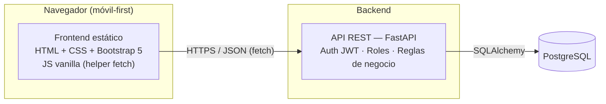
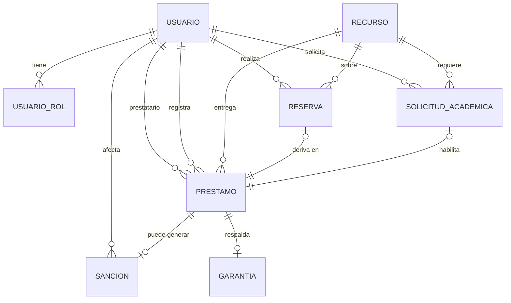
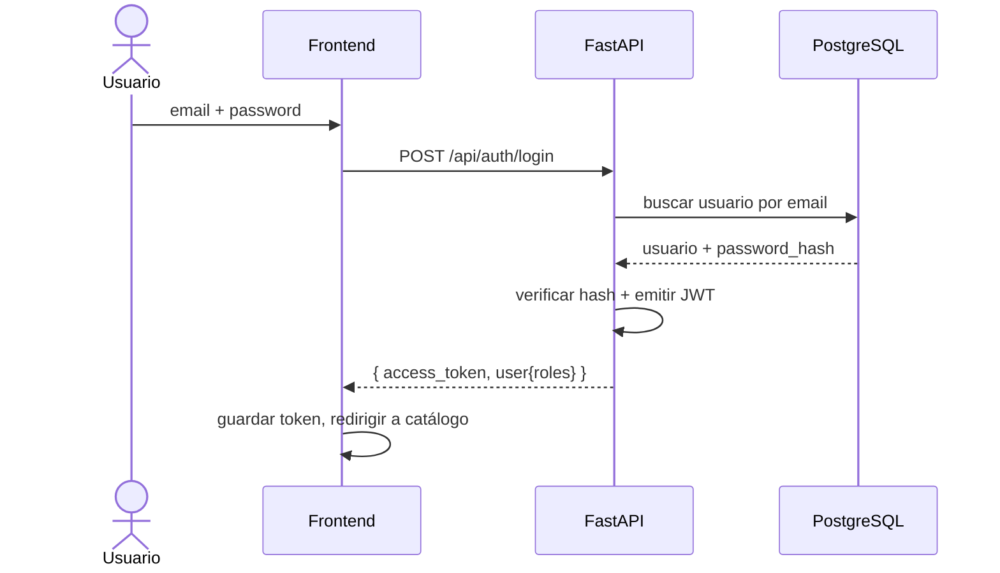
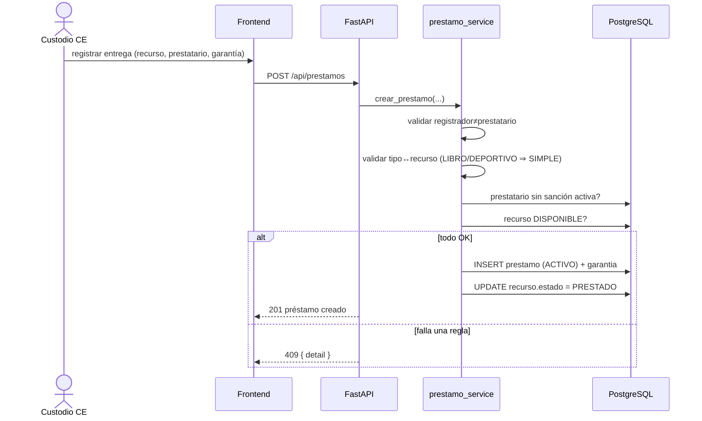
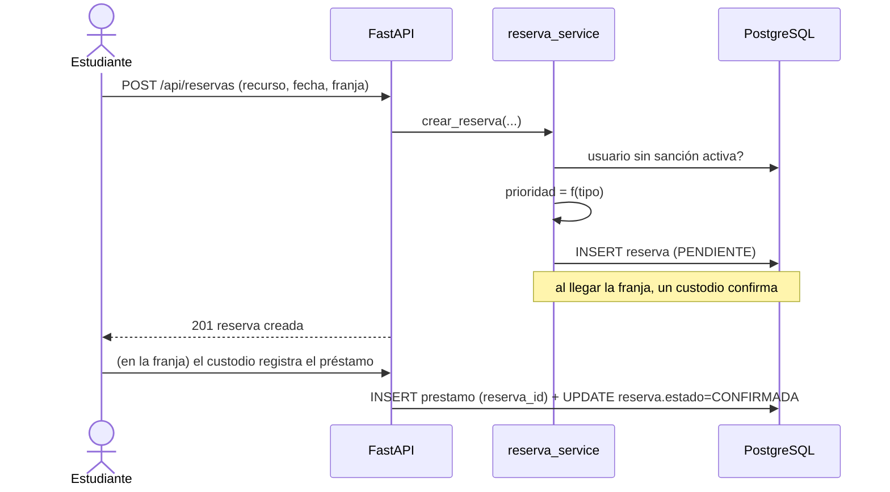
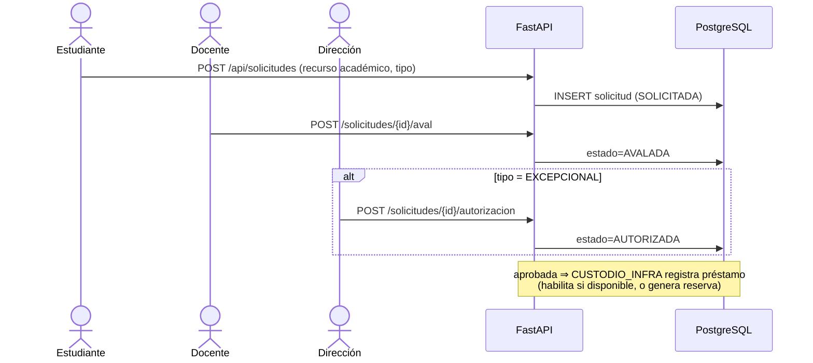
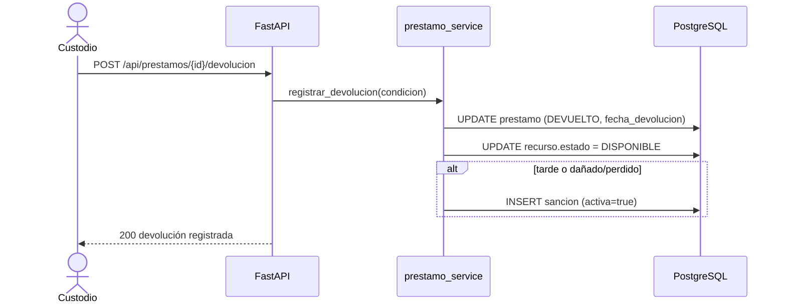

# SDD — Documento de Diseño de Software · Sistema de Préstamos (Grupo 8)

> Software Design Document (estilo IEEE-1016 adaptado). Describe **cómo** se construye el
> sistema especificado en [`00-contexto-alcance-propuesta.md`](00-contexto-alcance-propuesta.md).
> **Curso:** TI2 · EPCC · UNSA · 2026-B. **Fuente de verdad del diseño técnico.**

---

## 1. Introducción

### 1.1 Propósito
Guiar la construcción del Sistema de Préstamos: arquitectura, base de datos, API, componentes,
interfaz y seguridad. Sirve para que cada integrante entienda su tarea y para poder completar el
proyecto de forma coherente.

### 1.2 Alcance
Cubre el diseño de las 7 features (RF1–RF7) y los 4 RNF definidos en el doc oficial (§6).
La implementación se entrega por releases: **R1 (MVP)** → **R2** → **R3** (ver §7 del doc oficial).

### 1.3 Referencias
- Doc oficial (contexto, dominio, alcance): `00-contexto-alcance-propuesta.md`.
- Backlog e issues del sprint: repo → pestaña Issues (#1–#15) y Project #5.
- Estándares: IEEE-1016 (adaptado), REST, JWT (RFC 7519).

### 1.4 Convenciones
- **BD:** identificadores en `snake_case`; claves primarias `id` (entero autoincremental).
- **JSON de la API:** `snake_case` (coincide con los nombres de BD para no confundir a los juniors).
- **Enums:** en MAYÚSCULAS, idénticos al diccionario de datos del doc oficial (§4).
- **Fechas:** ISO-8601 (`YYYY-MM-DD` / `YYYY-MM-DDTHH:MM:SSZ`).

---

## 2. Arquitectura

### 2.1 Estilo arquitectónico
Aplicación web de **3 capas** con **frontend desacoplado** que consume una **API REST**:



### 2.2 Stack
| Capa | Tecnología |
|---|---|
| Frontend | HTML5 · CSS3 · **Bootstrap 5** · JavaScript (vanilla) + helper `fetch`/render |
| Backend | **FastAPI** (Python) · Pydantic (validación) · **SQLAlchemy** (ORM) |
| Auth | JWT (login propio mock institucional) · hashing con `passlib[bcrypt]` |
| BD | **PostgreSQL** |
| Infra dev | `uvicorn` (servidor ASGI) · `.env` para configuración · seeds de datos |

### 2.3 Estructura de carpetas propuesta (repo)
```
ti2-sistema-prestamos/
├── docs/                 # 00-contexto, 01-sdd, diagramas
├── backend/
│   ├── app/
│   │   ├── main.py       # arranque FastAPI + routers
│   │   ├── database.py   # engine + session SQLAlchemy
│   │   ├── models/       # entidades ORM
│   │   ├── schemas/      # Pydantic (request/response)
│   │   ├── routers/      # endpoints por feature (auth, recursos, ...)
│   │   ├── services/     # reglas de negocio (prioridad, invariantes, aprobación)
│   │   ├── security.py   # JWT, hashing, dependencias de rol
│   │   └── seeds.py      # datos de ejemplo
│   ├── requirements.txt
│   └── .env.example
└── frontend/
    ├── index.html        # login
    ├── catalogo.html
    ├── ...               # una página por vista
    ├── css/
    └── js/
        ├── api.js        # helper fetch (token, GET/POST, manejo de error)
        ├── render.js     # helpers de render (listas, formularios)
        └── <pagina>.js   # lógica por página
```

### 2.4 Flujo general de una petición
1. El usuario interactúa con una página estática (formulario/botón).
2. `api.js` hace `fetch` a la API con el JWT en el header `Authorization: Bearer <token>`.
3. FastAPI valida el token, verifica el rol (dependencia), aplica reglas de negocio (service).
4. SQLAlchemy consulta/escribe en PostgreSQL.
5. La API responde JSON; `render.js` pinta el resultado.

---

## 3. Diseño de datos

Modelo relacional derivado del diccionario de datos del doc oficial (§4). La herencia de
`Recurso` se resuelve con **tabla única + discriminador** (`tipo_recurso`) por simplicidad.

### 3.1 Enumeraciones (tipos Postgres)
| Enum | Valores |
|---|---|
| `rol` | ESTUDIANTE · DOCENTE · CUSTODIO_CE · CUSTODIO_INFRA · DIRECCION_ESCUELA · ADMINISTRADOR_SISTEMA |
| `gestor` | CENTRO_ESTUDIANTES · INFRAESTRUCTURA |
| `tipo_recurso` | LIBRO · DEPORTIVO · ACADEMICO |
| `estado_recurso` | DISPONIBLE · RESERVADO · PRESTADO · MANTENIMIENTO |
| `estado_reserva` | PENDIENTE · CONFIRMADA · CANCELADA · VENCIDA |
| `tipo_solicitud` | POR_CURSO · EXCEPCIONAL |
| `estado_solicitud` | SOLICITADA · AVALADA · AUTORIZADA · RECHAZADA |
| `tipo_prestamo` | SIMPLE · POR_CURSO · EXCEPCIONAL |
| `estado_prestamo` | ACTIVO · DEVUELTO · ATRASADO |
| `modalidad_uso` | EN_SITIO · RETIRO_TEMPORAL |
| `motivo_sancion` | RETRASO · DANIO · PERDIDA |

### 3.2 Modelo relacional (diagrama)


### 3.3 Tablas (DDL PostgreSQL)
```sql
-- Identidad y roles
CREATE TABLE usuario (
  id            SERIAL PRIMARY KEY,
  codigo        VARCHAR(20) UNIQUE NOT NULL,   -- CUI / código institucional
  nombres       VARCHAR(120) NOT NULL,
  email         VARCHAR(120) UNIQUE NOT NULL,
  password_hash VARCHAR(255) NOT NULL,         -- añadido para auth (no está en el dominio)
  activo        BOOLEAN NOT NULL DEFAULT TRUE,
  created_at    TIMESTAMPTZ NOT NULL DEFAULT now()
);

CREATE TABLE usuario_rol (               -- Usuario N–N Rol
  usuario_id INTEGER NOT NULL REFERENCES usuario(id) ON DELETE CASCADE,
  rol        rol NOT NULL,
  PRIMARY KEY (usuario_id, rol)
);

-- Catálogo (tabla única + discriminador)
CREATE TABLE recurso (
  id             SERIAL PRIMARY KEY,
  codigo         VARCHAR(30) UNIQUE NOT NULL,
  nombre         VARCHAR(120) NOT NULL,
  descripcion    TEXT,
  ubicacion      VARCHAR(120),
  estado         estado_recurso NOT NULL DEFAULT 'DISPONIBLE',
  gestor         gestor NOT NULL,
  tipo_recurso   tipo_recurso NOT NULL,
  -- Libro
  isbn           VARCHAR(20),
  autor          VARCHAR(120),
  categoria      VARCHAR(60),
  -- Deportivo
  tipo_deportivo VARCHAR(60),
  -- Académico
  codigo_patrimonial VARCHAR(60),
  requiere_aval  BOOLEAN,
  -- Coherencia gestor ↔ tipo
  CONSTRAINT chk_gestor_tipo CHECK (
    (tipo_recurso = 'ACADEMICO' AND gestor = 'INFRAESTRUCTURA')
    OR (tipo_recurso IN ('LIBRO','DEPORTIVO') AND gestor = 'CENTRO_ESTUDIANTES')
  )
);

-- Reservas (booking)
CREATE TABLE reserva (
  id          SERIAL PRIMARY KEY,
  usuario_id  INTEGER NOT NULL REFERENCES usuario(id),
  recurso_id  INTEGER NOT NULL REFERENCES recurso(id),
  fecha       DATE NOT NULL,
  franja      VARCHAR(30) NOT NULL,           -- p.ej. "10:00-12:00"
  estado      estado_reserva NOT NULL DEFAULT 'PENDIENTE',
  prioridad   INTEGER NOT NULL DEFAULT 0,     -- deriva del tipo (ver §3.4)
  created_at  TIMESTAMPTZ NOT NULL DEFAULT now()
);

-- Solicitudes académicas (solo POR_CURSO / EXCEPCIONAL sobre recursos ACADEMICO)
CREATE TABLE solicitud_academica (
  id               SERIAL PRIMARY KEY,
  solicitante_id   INTEGER NOT NULL REFERENCES usuario(id),
  recurso_id       INTEGER NOT NULL REFERENCES recurso(id),
  motivo           TEXT NOT NULL,
  fecha            DATE NOT NULL DEFAULT CURRENT_DATE,
  tipo             tipo_solicitud NOT NULL,
  estado           estado_solicitud NOT NULL DEFAULT 'SOLICITADA',
  avalado_por_id     INTEGER REFERENCES usuario(id),   -- docente
  autorizado_por_id  INTEGER REFERENCES usuario(id)    -- dirección
);

-- Préstamos (núcleo)
CREATE TABLE prestamo (
  id                  SERIAL PRIMARY KEY,
  recurso_id          INTEGER NOT NULL REFERENCES recurso(id),
  prestatario_id      INTEGER NOT NULL REFERENCES usuario(id),
  registrado_por_id   INTEGER NOT NULL REFERENCES usuario(id),
  reserva_id          INTEGER REFERENCES reserva(id),
  solicitud_id        INTEGER REFERENCES solicitud_academica(id),
  fecha_entrega       TIMESTAMPTZ NOT NULL DEFAULT now(),
  fecha_limite        TIMESTAMPTZ NOT NULL,
  fecha_devolucion    TIMESTAMPTZ,
  estado              estado_prestamo NOT NULL DEFAULT 'ACTIVO',
  tipo_prestamo       tipo_prestamo NOT NULL,
  modalidad_uso       modalidad_uso NOT NULL,
  condicion_entrega   TEXT,
  condicion_devolucion TEXT,
  -- Invariante: un custodio no se autoregistra un préstamo
  CONSTRAINT chk_registrador_distinto CHECK (registrado_por_id <> prestatario_id)
);

-- Garantía (1–0..1 con préstamo)
CREATE TABLE garantia (
  id          SERIAL PRIMARY KEY,
  prestamo_id INTEGER UNIQUE NOT NULL REFERENCES prestamo(id) ON DELETE CASCADE,
  tipo        VARCHAR(60) NOT NULL,       -- p.ej. "CARNET", "DNI"
  valor       NUMERIC(10,2) NOT NULL DEFAULT 0,
  devuelta    BOOLEAN NOT NULL DEFAULT FALSE
);

-- Sanciones
CREATE TABLE sancion (
  id          SERIAL PRIMARY KEY,
  usuario_id  INTEGER NOT NULL REFERENCES usuario(id),
  prestamo_id INTEGER REFERENCES prestamo(id),
  motivo      motivo_sancion NOT NULL,
  inicio      DATE NOT NULL DEFAULT CURRENT_DATE,
  fin         DATE,
  monto       NUMERIC(10,2) NOT NULL DEFAULT 0,
  activa      BOOLEAN NOT NULL DEFAULT TRUE
);

-- Reportes (vista/registro de solo lectura; se construye a partir de eventos)
CREATE TABLE reporte (
  id            SERIAL PRIMARY KEY,
  tipo          VARCHAR(60) NOT NULL,
  generado_en   TIMESTAMPTZ NOT NULL DEFAULT now(),
  generado_por_id INTEGER REFERENCES usuario(id)
);
```

### 3.4 Invariantes y reglas (capa de servicio)
Además de los `CHECK` de BD, la **capa de servicio** garantiza:
- **Tipo ↔ recurso (estricto):** `SIMPLE` solo si `recurso.tipo_recurso ∈ {LIBRO, DEPORTIVO}`;
  `POR_CURSO`/`EXCEPCIONAL` solo si `= ACADEMICO`. *(Cruza tablas → se valida en el service; se
  puede reforzar con un trigger opcional.)*
- **Aprobar ≠ registrar:** un `SIMPLE` se aprueba automáticamente (sin sanción + recurso
  DISPONIBLE); la entrega la registra un custodio (crea la fila `prestamo`).
- **Bloqueo por sanción:** no se permite crear reserva/solicitud/préstamo si el usuario tiene
  alguna `sancion.activa = TRUE`.
- **Prioridad de reserva:** `prioridad` = 3 si EXCEPCIONAL, 2 si POR_CURSO, 1 si SIMPLE. El
  desempate entre reservas del mismo recurso es por `prioridad DESC, created_at ASC` (FIFO).
- **Marcar vencidos:** un proceso/consulta cambia a `ATRASADO` los préstamos `ACTIVO` cuyo
  `fecha_limite < now()`.

---

## 4. Diseño de la API (contrato REST)

> Los endpoints del 30% (`POST /auth/login` y `GET /recursos`) están detallados campo por
> campo en [`02-contrato-api.md`](02-contrato-api.md) — esa es la referencia para el frontend.
> Esta sección es el mapa general de toda la API.

- **Base URL:** `/api`  · **Auth:** `Authorization: Bearer <JWT>` (salvo `POST /auth/login`).
- **Errores:** `{ "detail": "mensaje" }` con código HTTP apropiado (400/401/403/404/409/422).
- **Roles:** el rol requerido se indica por endpoint. `[público]` = sin token.

### 4.1 Autenticación y usuarios (RF7) — issues #4, #7.2
| Método | Ruta | Rol | Descripción |
|---|---|---|---|
| POST | `/api/auth/login` | [público] | Login, devuelve JWT |
| GET | `/api/auth/me` | autenticado | Datos del usuario actual + roles |
| GET | `/api/usuarios` | ADMINISTRADOR_SISTEMA | Listar usuarios |
| POST | `/api/usuarios` | ADMINISTRADOR_SISTEMA | Crear usuario |
| PUT | `/api/usuarios/{id}/roles` | ADMINISTRADOR_SISTEMA | Asignar/quitar roles |

```jsonc
// POST /api/auth/login  (request)
{ "email": "diego@unsa.edu.pe", "password": "••••••" }
// 200 (response)
{ "access_token": "eyJ...", "token_type": "bearer",
  "user": { "id": 1, "nombres": "Diego Ramírez", "roles": ["ESTUDIANTE"] } }
// 401 -> { "detail": "Credenciales inválidas" }
```

### 4.2 Catálogo / Inventario (RF1) — issues #7, #8
| Método | Ruta | Rol | Descripción |
|---|---|---|---|
| GET | `/api/recursos` | autenticado | Listar (filtros: `tipo`, `estado`, `disponible`, `q`) |
| GET | `/api/recursos/{id}` | autenticado | Detalle |
| POST | `/api/recursos` | CUSTODIO_CE / CUSTODIO_INFRA | Alta |
| PUT | `/api/recursos/{id}` | CUSTODIO_CE / CUSTODIO_INFRA | Editar |
| PATCH | `/api/recursos/{id}/estado` | CUSTODIO_CE / CUSTODIO_INFRA | Cambiar estado |
| DELETE | `/api/recursos/{id}` | CUSTODIO_CE / CUSTODIO_INFRA | Baja |

```jsonc
// GET /api/recursos?tipo=LIBRO&disponible=true  -> 200
[ { "id": 10, "codigo": "LIB-001", "nombre": "Clean Code",
    "tipo_recurso": "LIBRO", "estado": "DISPONIBLE", "gestor": "CENTRO_ESTUDIANTES",
    "isbn": "978-0132350884", "autor": "Robert C. Martin" } ]
```

### 4.3 Reservas (RF2) — issues #10, #11
| Método | Ruta | Rol | Descripción |
|---|---|---|---|
| POST | `/api/reservas` | autenticado (sin sanción) | Reservar (calcula prioridad) |
| GET | `/api/reservas?mias=true` | autenticado | Mis reservas |
| DELETE | `/api/reservas/{id}` | dueño de la reserva | Cancelar |

```jsonc
// POST /api/reservas  -> 201
{ "recurso_id": 10, "fecha": "2026-09-25", "franja": "10:00-12:00" }
// 409 -> { "detail": "Tienes una sanción activa" }
```

### 4.4 Préstamos / Devoluciones (RF3) — issues #13, #14
| Método | Ruta | Rol | Descripción |
|---|---|---|---|
| POST | `/api/prestamos` | CUSTODIO_CE / CUSTODIO_INFRA | Registrar entrega (aplica invariantes) |
| POST | `/api/prestamos/{id}/devolucion` | CUSTODIO_CE / CUSTODIO_INFRA | Registrar devolución |
| GET | `/api/prestamos?mios=true` | autenticado | Mis préstamos (ver plazo) |
| GET | `/api/prestamos?estado=ATRASADO` | custodios | Préstamos vencidos |

```jsonc
// POST /api/prestamos  (custodio registra)  -> 201
{ "recurso_id": 10, "prestatario_id": 1, "tipo_prestamo": "SIMPLE",
  "modalidad_uso": "RETIRO_TEMPORAL", "condicion_entrega": "Buen estado",
  "garantia": { "tipo": "CARNET", "valor": 0 } }
// 409 -> { "detail": "El registrador no puede ser el prestatario" }
// 409 -> { "detail": "Un libro solo admite préstamo SIMPLE" }
```

### 4.5 Solicitudes académicas (RF4)
| Método | Ruta | Rol | Descripción |
|---|---|---|---|
| POST | `/api/solicitudes` | autenticado (sin sanción) | Crear solicitud (POR_CURSO/EXCEPCIONAL) |
| POST | `/api/solicitudes/{id}/aval` | DOCENTE | Avalar |
| POST | `/api/solicitudes/{id}/autorizacion` | DIRECCION_ESCUELA | Autorizar |
| POST | `/api/solicitudes/{id}/rechazo` | DOCENTE / DIRECCION_ESCUELA / CUSTODIO_INFRA | Rechazar |
| GET | `/api/solicitudes?pendientes=aval\|autorizacion` | DOCENTE / DIRECCION | Bandeja |

### 4.6 Sanciones (RF5)
| Método | Ruta | Rol | Descripción |
|---|---|---|---|
| POST | `/api/sanciones` | CUSTODIO_CE / CUSTODIO_INFRA | Registrar sanción (daño/pérdida/retraso) |
| GET | `/api/sanciones?mias=true` | autenticado | Mis sanciones |
| PATCH | `/api/sanciones/{id}/levantar` | custodios | Marcar `activa=false` |

### 4.7 Historial y reportes (RF6)
| Método | Ruta | Rol | Descripción |
|---|---|---|---|
| GET | `/api/historial?usuario_id=` | autenticado (propio) / dirección | Historial de préstamos |
| GET | `/api/reportes/inventario` | DIRECCION_ESCUELA | Reporte de inventario |
| GET | `/api/reportes/prestamos` | DIRECCION_ESCUELA | Reporte de préstamos |

---

## 5. Diseño de componentes

### 5.1 Backend (por módulo)
| Módulo | Responsabilidad |
|---|---|
| `models/` | Entidades ORM (una clase por tabla de §3). |
| `schemas/` | Modelos Pydantic de request/response (validación y serialización). |
| `routers/` | Un archivo por feature: `auth.py`, `recursos.py`, `reservas.py`, `prestamos.py`, `solicitudes.py`, `sanciones.py`, `reportes.py`, `usuarios.py`. Solo enrutan y llaman a services. |
| `services/` | Reglas de negocio: `prestamo_service` (invariantes, aprobación SIMPLE, vencidos), `reserva_service` (prioridad), `sancion_service` (bloqueo). **Aquí vive lo difícil (Cristhian).** |
| `security.py` | Hash de contraseñas, emisión/validación JWT, dependencias `require_role(...)`. |
| `database.py` | Engine + `SessionLocal` + `get_db()`. |
| `seeds.py` | Carga de datos de ejemplo. |

### 5.2 Frontend (por archivo)
| Archivo | Responsabilidad |
|---|---|
| `js/api.js` | **Helper `fetch`** (Cristhian): adjunta el token, expone `get/post/put/del`, maneja errores 401/403. |
| `js/render.js` | Helpers de render (tablas, tarjetas, formularios, estados vacío/carga/error). |
| `js/<pagina>.js` | Lógica de cada vista: llama a `api.js`, usa `render.js`. Es lo que rellenan los juniors. |
| `*.html` | Estructura y estilos (Bootstrap) de cada pantalla. |

> Contrato entre capas: el frontend **solo** conoce la API por §4; no asume nombres de columnas
> más allá de lo que devuelve el JSON.

---

## 6. Diseño de interfaz (UI)

### 6.1 Pantallas por rol
| Pantalla | Estudiante | Custodio CE | Custodio Infra | Docente | Dirección | Admin |
|---|:--:|:--:|:--:|:--:|:--:|:--:|
| Login | ✅ | ✅ | ✅ | ✅ | ✅ | ✅ |
| Catálogo / disponibilidad | ✅ | ✅ | ✅ | ✅ | ✅ | — |
| Alta/edición de recurso | — | ✅ | ✅ | — | — | — |
| Reservar / mis reservas | ✅ | — | — | ✅ | — | — |
| Registrar préstamo/devolución | — | ✅ | ✅ | — | — | — |
| Mis préstamos (plazo) | ✅ | ✅ | ✅ | ✅ | — | — |
| Solicitud académica | ✅ | — | — | ✅ | — | — |
| Bandeja aval / autorización | — | — | ✅ | ✅ | ✅ | — |
| Mis sanciones | ✅ | ✅ | ✅ | ✅ | — | — |
| Registrar sanción | — | ✅ | ✅ | — | — | — |
| Historial | ✅ | — | — | ✅ | ✅ | — |
| Reportes | — | — | — | — | ✅ | — |
| Gestión de usuarios/roles | — | — | — | — | — | ✅ |

### 6.2 Principios de UI
- **Móvil primero** (RNF2): layout de una columna en móvil, grid en escritorio (Bootstrap).
- **Estados explícitos** en toda vista de datos: *cargando* · *vacío* · *error* · *contenido*.
- **Navegación por rol:** el menú muestra solo lo que el rol puede hacer.
- **Feedback:** confirmaciones y mensajes de error claros (mapear el `detail` de la API).

### 6.3 Mockups
Los wireframes/mockups de alta fidelidad se producen en los issues **#9 (catálogo)** y
**#12 (login)** para el 30%, y el resto camino al 60%. Se enlazan aquí cuando existan.

---

## 7. Diseño de comportamiento (diagramas de secuencia)

### 7.1 Login (RF7)


### 7.2 Préstamo SIMPLE (RF3)


### 7.3 Reserva (booking) → derivar en préstamo (RF2)


### 7.4 Solicitud académica POR_CURSO / EXCEPCIONAL (RF4)


### 7.5 Devolución con posible sanción (RF3 + RF5)


---

## 8. Diseño de seguridad (RNF1)

- **Autenticación:** login propio (mock institucional). Al validar credenciales se emite un
  **JWT** firmado (HS256) con `sub` (id de usuario) y `roles`; expira (p. ej. 8 h). El frontend
  lo guarda y lo envía en `Authorization: Bearer`.
- **Contraseñas:** nunca en texto plano — hash con **bcrypt** (`password_hash`). Se usa la
  librería `bcrypt` directamente: `passlib` quedó sin mantenimiento desde 2020 y es
  incompatible con `bcrypt` 5.x.
- **Autorización por rol:** dependencia FastAPI `require_role(Rol.CUSTODIO_CE, ...)` que
  devuelve `403` si no corresponde. Los roles se leen **del usuario en base de datos**, no
  del token, para que quitar un permiso tenga efecto sin esperar a que expire el JWT.
  El `ADMINISTRADOR_SISTEMA` gestiona cuentas pero **no** aprueba préstamos (regla de
  negocio, no solo de UI).
- **Validación de entrada:** Pydantic valida y tipa todo request (evita inyección/valores inválidos).
- **Protección de datos (DNI/CUI):** no se exponen en respuestas salvo a roles autorizados;
  no se registran en logs.
- **CORS:** restringido al origen del frontend.
- **Auditoría:** `created_at` en entidades clave; los reportes (RF6) reconstruyen la trazabilidad.
- **Nota:** el **SSO institucional real de UNSA** queda fuera del prototipo (ver doc oficial §5).

---

## 9. Trazabilidad (RF/RNF → diseño → issues)

| Requisito | Tablas | Endpoints | Componentes | Issues |
|---|---|---|---|---|
| **RF1** Catálogo | `recurso` | `/api/recursos*` | `routers/recursos`, models | #7, #8, #9, #10, #11 |
| **RF2** Reservas | `reserva` | `/api/reservas*` | `reserva_service` (prioridad) | #10, #11 |
| **RF3** Préstamos | `prestamo`, `garantia` | `/api/prestamos*` | `prestamo_service` (invariantes, vencidos) | #13, #14 |
| **RF4** Autorización acad. | `solicitud_academica` | `/api/solicitudes*` | `routers/solicitudes` | (60%) |
| **RF5** Sanciones | `sancion` | `/api/sanciones*` | `sancion_service` (bloqueo) | (60/100%) |
| **RF6** Historial/Reportes | `reporte` (+ lectura) | `/api/historial`, `/api/reportes*` | `routers/reportes` | (100%) |
| **RF7** Usuarios/Roles | `usuario`, `usuario_rol` | `/api/auth*`, `/api/usuarios*` | `security.py`, `routers/auth` | #4, #6, #12, #13, #14 |
| **RNF1** Seguridad | — | (todos) | `security.py` | #4 |
| **RNF2** Usabilidad | — | — | frontend Bootstrap responsive | #9–#14 |
| **RNF3** Rendimiento | índices en `recurso`, `reserva` | `GET /api/recursos` | consultas eficientes | (60%) |
| **RNF4** Disponibilidad | — | — | despliegue | (100%) |

---

## Anexo — Estado del documento
- **§1–§8** cubren el diseño necesario para R1 (MVP) y sientan la base de R2/R3.
- Se actualiza por PR conforme avanza la implementación (documento vivo).
- Fuente de verdad del **qué**: `00-contexto-alcance-propuesta.md`. Del **cómo**: este SDD.
