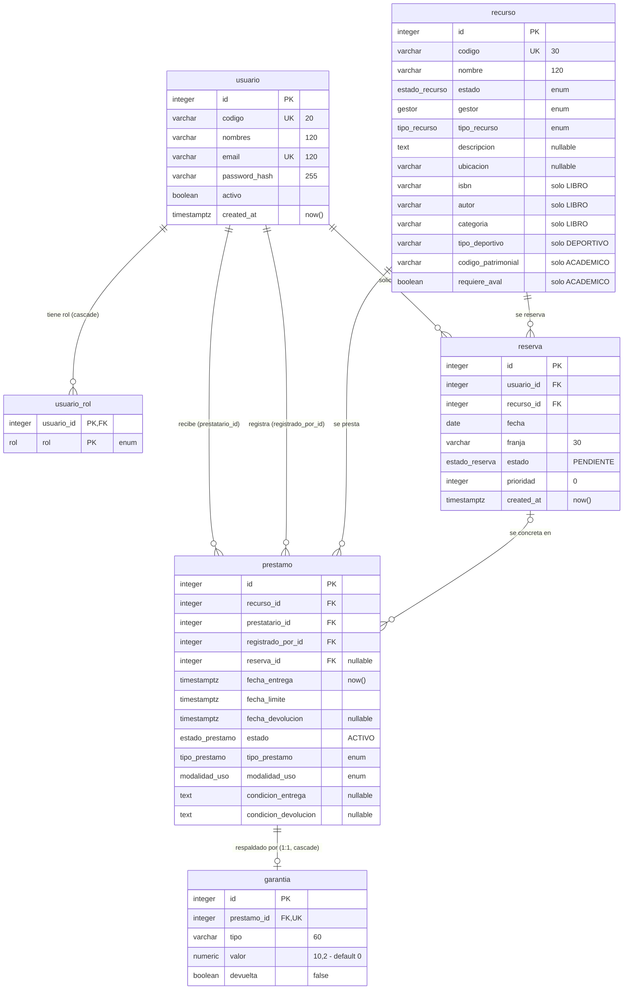

# Modelo de base de datos — Sistema de Préstamos (Grupo 8)

Generado desde el esquema real de PostgreSQL 16 (servicio `db` de `docker-compose.yml`).

Complementa a [`modelo-dominio.puml`](modelo-dominio.puml): aquel describe las clases
del dominio, este describe las tablas, columnas, tipos y claves reales.

El diagrama se renderiza solo en GitHub y en VS Code. Versión PlantUML equivalente
(con notas de los CHECK y los enums): [`modelo-bbdd.puml`](modelo-bbdd.puml).

## Diagrama entidad-relación



## Tipos enum

| Tipo | Valores |
|---|---|
| `rol` | ESTUDIANTE, DOCENTE, CUSTODIO_CE, CUSTODIO_INFRA, ADMINISTRADOR_SISTEMA |
| `tipo_recurso` | LIBRO, DEPORTIVO, ACADEMICO |
| `gestor` | CENTRO_ESTUDIANTES, INFRAESTRUCTURA |
| `estado_recurso` | DISPONIBLE, RESERVADO, PRESTADO, MANTENIMIENTO |
| `estado_reserva` | PENDIENTE, CONFIRMADA, CANCELADA, VENCIDA |
| `estado_prestamo` | ACTIVO, DEVUELTO, ATRASADO |
| `tipo_prestamo` | SIMPLE, POR_CURSO, EXCEPCIONAL |
| `modalidad_uso` | EN_SITIO, RETIRO_TEMPORAL |

## Restricciones CHECK

**`recurso.chk_gestor_tipo`** — amarra el tipo de recurso con quién lo gestiona:

- `ACADEMICO` → `gestor = INFRAESTRUCTURA`
- `LIBRO` o `DEPORTIVO` → `gestor = CENTRO_ESTUDIANTES`

**`prestamo.chk_registrador_distinto`** — `registrado_por_id <> prestatario_id`:
nadie puede registrar su propio préstamo.

## Notas de diseño

**`recurso` usa herencia de tabla única.** Las columnas específicas de cada tipo
(`isbn`/`autor`/`categoria` para libros, `tipo_deportivo`, `codigo_patrimonial`/
`requiere_aval`) conviven en la misma tabla y quedan en `NULL` cuando no aplican.
Por eso un `SELECT *` sale muy ancho y con huecos.

**`prestamo` apunta dos veces a `usuario`.** `prestatario_id` es quien recibe el
recurso y `registrado_por_id` el custodio que lo entrega; de ahí las dos relaciones
entre las mismas tablas en el diagrama.

**`prestamo.reserva_id` es opcional.** Un préstamo puede nacer de una reserva previa
o directamente en mostrador, sin reserva.

**`garantia` es 1:1 con `prestamo`.** El `UNIQUE` sobre `prestamo_id` es lo que lo
convierte en 1:1 en lugar de 1:N.

## Regenerar este diagrama

Los `.d` de psql son la fuente de verdad del esquema:

```bash
PGPASSWORD=prestamos psql -h localhost -p 5433 -U prestamos -d prestamos \
  -c '\d usuario' -c '\d recurso' -c '\d reserva' -c '\d prestamo' -c '\d garantia'
```

Volcar el esquema completo (sin datos) a un `.sql`:

```bash
docker compose exec -T db pg_dump -U prestamos -d prestamos --schema-only > docs/esquema.sql
```
